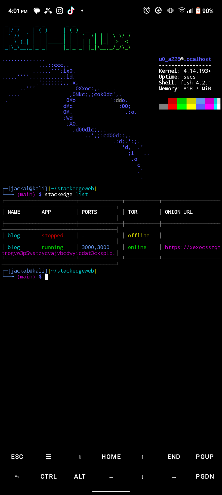
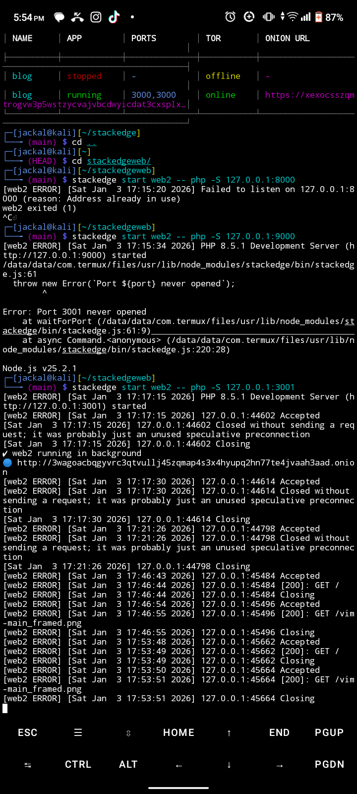

### Stackedge

**Supports Vercel deployment** · **[Vercel deploy →](https://github.com/Frost-bit-star/stackfrp)**

<div align="center">

[](https://github.com/Frost-bit-star/stackedge)
[](https://github.com/Frost-bit-star/stackfrp)
[](https://nodejs.org/)
[](https://github.com/Frost-bit-star/stackedge#built-in-security-engine)
[](https://github.com/Frost-bit-star/stackedge/issues)
[](https://github.com/Frost-bit-star/stackedge/pulls)
[](https://github.com/Frost-bit-star/stackedge/blob/main/package.json)

</div>

<div align="center">
  
</div>

## Decentralized App Hosting with Tor - Termux, Linux servers and VPS

Stackedge runs any web app (Node.js, PHP, Go, Python, static sites...) in the background and
exposes it through a Tor onion service. It works the same on an Android phone (Termux),
a Debian/Ubuntu VPS, Fedora, Arch, Alpine or a Mac - no fixed ports, no fixed paths.

Your apps start immediately, Tor is installed and bootstrapped for you, and after a server
reboot everything comes back on its own.

**Features**

- Run any app from any folder - Node.js, PHP, Go, Python, anything with a command.

- **Any port**: use `--port 8080`, `--port 4242`, or none at all and stackedge picks a free one.

- **Works everywhere**: Termux, Linux servers, VPS, macOS. The Tor binary and all paths are
  auto-detected - nothing is hardcoded to one machine.

- **Installs Tor for you** if it is missing (`apt`, `dnf`, `pacman`, `apk`, `zypper`, `brew`, Termux `pkg`).

- **Survives reboots**: `stackedge daemon install` registers a systemd service (or cron
  `@reboot`, or a shell hook on Termux) that restores your apps on boot.

- Coexists with a system Tor daemon: if the default control port is taken, stackedge
  automatically moves to a free one.

- **Built-in Security Engine**: a lightweight Node.js reverse proxy with Nginx-style security
  headers, rate limiting, request limits, method and Host validation, path-traversal blocking,
  access logging and an audit score. Enabled by default, no Nginx required.

- **Vercel deployment**: publish any app through its own Vercel FRPS gateway with
  `stackedge vercel init`, `deploy`, `probe` and `connect`. No incoming device port is needed.

- CLI similar to pm2: `start`, `stop`, `restart`, `delete`, `list`, `resurrect`, `logs`,
  plus `stackedge security <status|enable|disable|audit|fix|headers|logs|rules|reset>`.

**Open-source and focused on privacy & decentralization.**

---

### Table of Contents

- [Requirements](#requirements)
- [Install](#install)
- [Usage](#usage)
- [Commands](#commands)
- [Boot integration (reboots)](#boot-integration-reboots)
- [Configuration](#configuration)
- [Security Engine](#security-engine)
- [Data directory](#data-directory)
- [Dashboard & Screenshots](#dashboard--screenshots)
- [Tor onion testing](#tor-onion-testing)
- [Project philosophy](#project-philosophy)
- [Support](#support)

---

### Requirements

**Android / Termux**

```
pkg update -y && pkg upgrade -y
pkg install nodejs git -y
```

**Linux server / VPS (Debian, Ubuntu, Fedora, Arch, Alpine...)**
Node.js 18+ (`node -v` to check). Everything else - including Tor - is installed for you.

**Optional runtimes for your apps**

```
Termux:  pkg install php golang python -y
Debian:  sudo apt install php golang python3 -y
```

---

### Install

```
npm install -g stackedge
```

Then run the one-shot setup. On a server this installs Tor (if missing) and registers boot
integration so your apps come back after a reboot:

```
stackedge setup
```

Prefer to do it by hand? Then just run the two pieces separately:

```
stackedge daemon install     # start apps on boot (systemd / cron / shell hook)
```

Verify:

```
stackedge            # shows the command list
stackedge daemon status
```

---

### Usage

Navigate to the project you want to host and start it:

```
cd ~/my-react-app
stackedge start blog -- npm start
```

- `blog` is the app name.
- Everything after `--` is the command used to start the app.

Output:

```
✔ blog running in background on port 45123
  logs: /home/you/.stackedge/logs/blog.log
🌐 http://generated-onion-address.onion
```

#### Any port

Stackedge never forces ports. Pick one:

```
stackedge start api --port 8080 -- node server.js
stackedge start site --port 4242 -- python3 -m http.server
stackedge start blog -- npm start                      # free port is picked for you
```

The port is also taken from, in this order:

1. `--port` flag
2. the command itself (`--port 4000`, `127.0.0.1:4000`, `http.server 8080`)
3. the `PORT` environment variable
4. any free port the OS hands out

Your app receives it through the `PORT` (and `SSL_PORT`) environment variables, so frameworks
that already honour `PORT` work without changes.

Apps that bind a specific interface can use `--host`:

```
stackedge start lan --host 10.0.0.5 --port 3000 -- npm start
```

---

### Commands

| Command | Description |
| --- | --- |
| `stackedge start <name> [--port <n>] [--ssl-port <n>] [--host <ip>] -- <cmd>` | Start an app and publish it as an onion service |
| `stackedge stop <name>` | Stop an app (kills its whole process group) |
| `stackedge restart <name>` | Restart an app on the same ports |
| `stackedge delete <name>` | Remove an app and its onion service |
| `stackedge list` | Table of apps, states, ports and onion URLs |
| `stackedge list --full` | Same, plain text, never truncated (easy to copy) |
| `stackedge onion [name]` | Print the complete onion URL of one app (or all) |
| `stackedge resurrect` | Restore every app (after a reboot or network drop) |
| `stackedge logs <name> [-n 100]` | Show recent app logs |
| `stackedge daemon <install\|uninstall\|status>` | Manage boot integration |
| `stackedge setup` | Install Tor if missing + install boot integration |
| `stackedge security status` | Show engine state, config path and score |
| `stackedge security enable` / `disable` | Turn the security engine on or off |
| `stackedge security audit` | Run configuration checks and print a score |
| `stackedge security fix` | Apply safe automatic fixes |
| `stackedge security headers` | Show currently injected HTTP headers |
| `stackedge security logs [-n 100]` | Show recent security events |
| `stackedge security rules` | Show active security rules |
| `stackedge security reset` | Restore the default security configuration |
| `stackedge start <name> --vercel -- <cmd>` | Start an app and generate its Vercel deployment |
| `stackedge vercel init <name>` | Generate a unique Vercel FRPS project and credentials |
| `stackedge vercel deploy <name> <url>` | Save the Vercel URL for the generated deployment |
| `stackedge vercel probe <name>` | Verify deployment identity, auth, WebSocket and routing |
| `stackedge vercel connect <name>` | Start the outbound FRPC tunnel in the background |
| `stackedge vercel disconnect <name>` | Stop the tunnel |
| `stackedge vercel reconnect <name>` | Restart the tunnel |
| `stackedge vercel status [name]` | Show deployments and tunnel state |
| `stackedge vercel logs <name> [-n 100]` | Show tunnel logs |
| `stackedge vercel remove <name>` | Remove a Vercel deployment |

---

### Vercel publishing

Stackedge generates one FRPS deployment per app. The generated project lives in
`~/.stackedge/vercel/<app>/project` and is deployed to Vercel; the FRPC client stays inside
this CLI and dials the deployment outbound through the local Stackedge security proxy.
The generated `config.json` carries the service ID and token, so Hobby deployments work
without setting Vercel environment variables. Keep the generated project private because
that file contains a live bearer token. No Redis, database, VPS or incoming device port
is required.

```sh
stackedge start myapp --port 3000 --vercel -- npm start
# deploy ~/.stackedge/vercel/myapp/project to Vercel
stackedge vercel deploy myapp https://myapp.vercel.app
stackedge vercel probe myapp
stackedge vercel connect myapp
```

Always run `stackedge vercel probe <app>` before relying on the deployment. Vercel Functions
are isolated; if the probe reports `cross-instance` routing, the deployment cannot relay public
requests transparently. Use the generated `server.js` on a long-lived Node runtime instead.

---

### Boot integration (reboots)

`stackedge daemon install` picks whatever fits the machine:

1. **systemd (system service)** - when running as root, or when passwordless `sudo` is
   available. Writes `/etc/systemd/system/stackedge.service` and enables it.
2. **systemd (user service)** - otherwise, writes
   `~/.config/systemd/user/stackedge.service` and enables login lingering, so apps start
   on boot without anyone logging in.
3. **cron `@reboot`** - for servers without systemd.
4. **Shell hook** - Termux and other systems: the line is added to `~/.bashrc` / `~/.zshrc`
   / `~/.profile`, which is how apps are restored when Termux is opened.

Remove it again with `stackedge daemon uninstall` (your apps and data stay untouched) and
inspect it with `stackedge daemon status`.

**Termux auto-resurrect by hand** (same thing the shell hook does):

```
echo 'if command -v stackedge >/dev/null; then stackedge resurrect >/dev/null 2>&1 & fi' >> ~/.bashrc
```

---

### Configuration

All settings are optional environment variables - nothing is hardcoded to one machine.

| Variable | Default | Meaning |
| --- | --- | --- |
| `TOR_BIN` | auto-detected | Path to the `tor` binary |
| `STACKEDGE_HOME` | `~/.stackedge` | Where apps, logs and Tor data live |
| `STACKEDGE_TOR_CONTROL_PORT` | `9051` | Tor control port (auto-moves if taken) |
| `STACKEDGE_TOR_SOCKS_PORT` | `0` (disabled) | Expose a local SOCKS port from Tor |
| `STACKEDGE_APP_HOST` | `127.0.0.1` | Address onion traffic is forwarded to |
| `STACKEDGE_BOOTSTRAP_TIMEOUT` | `180000` | How long to wait for Tor (ms) |
| `PORT` / `SSL_PORT` | auto | Default ports for the next `start` |

Example on a VPS where another Tor already owns 9051:

```
export STACKEDGE_TOR_CONTROL_PORT=9151
stackedge start blog -- npm start
```

---

### Security Engine

Stackedge puts a lightweight HTTP security proxy between Tor and your app. No Nginx install,
no extra system packages - the proxy is plain Node.js, so it works on Termux, Linux, VPS and
macOS.

```
Tor network -> onion service -> Stackedge Security Engine -> application port
                                   |  rate limit / host + method + path checks
                                   |  body + header limits / timeouts
                                   |  security headers / access log
```

When security is enabled (the default), `stackedge start` allocates a loopback-only proxy
port for the app, starts the proxy as a detached process and points `HiddenServicePort 80`
at the proxy instead of the application. The app itself keeps listening on `127.0.0.1`;
Tor never gets a direct route to the backend port. `stop`, `restart`, `delete` and
`resurrect` manage the proxy along with the app.

Edit `~/.stackedge/security.json` (created with defaults on first write). All fields are
optional and are merged with the defaults:

```json
{
  "security": {
    "enabled": true,
    "headers": {
      "x-frame-options": "DENY",
      "x-content-type-options": "nosniff",
      "referrer-policy": "strict-origin-when-cross-origin",
      "x-xss-protection": "0",
      "content-security-policy": "default-src 'self'"
    },
    "rateLimit": {
      "enabled": true,
      "requests": 100,
      "window": 60,
      "blockDuration": 300
    },
    "requestLimits": {
      "maxBodySize": "10mb",
      "maxHeaderSize": "16kb",
      "timeout": 30000
    },
    "methods": ["GET", "POST", "HEAD", "OPTIONS"],
    "directoryListing": false,
    "pathTraversalProtection": true,
    "hostValidation": true,
    "allowedHosts": [],
    "accessLog": true,
    "connectionLimit": 100,
    "cluster": {
      "enabled": true,
      "workers": "auto"
    },
    "tls": { "enabled": false, "cert": "", "key": "" }
  }
}
```

Notes on the defaults:

- `content-security-policy` is intentionally strict. Applications that load external scripts,
  fonts or images need a custom CSP; change it, don't remove the whole header.
- `allowedHosts` is optional. Onion hostnames from the registry and `localhost` are accepted
  automatically.
- `tls` protects the local hop when other devices on the LAN can reach the proxy. The proxy
  still listens on `127.0.0.1` only. Certificate paths may be absolute or relative to
  `~/.stackedge`.
- `cluster.workers: "auto"` forks one proxy worker per detected CPU core (capped at 16) so
  traffic is not stuck on a single core. Set a number from `1` to `64` to tune it, or
  `cluster.enabled: false` for a single process. Rate limiting and the audit score stay global
  across workers; the per-worker connection cap is `connectionLimit / workers`.
- Only the security proxy is forked. Your app command is still started once: arbitrary apps
  cannot safely be duplicated (they may not be cluster-aware or may share writable state).
- Rule changes are picked up when the proxy restarts: run `stackedge restart <name>` (or
  `stackedge security enable` for every app).
- `stackedge start --ssl-port` keeps the virtual `443` mapping pointed straight at the app's
  TLS listener. The security engine currently filters the HTTP (`80`) mapping only.
- Tor clients do not have a meaningful public client IP. When a request arrives from loopback
  the rate limiter uses one shared bucket, so it protects the backend from flooding but cannot
  distinguish individual onion users. Don't rely on IP blocking for onion services.

Rejected and completed requests are written as JSON lines to
`~/.stackedge/logs/security.log`. Query strings and header values are not logged. Application
output stays in `~/.stackedge/logs/<name>.log`.

```
stackedge security status       # is it on, where is the config, current score
stackedge security headers      # effective headers
stackedge security rules        # effective rules
stackedge security logs -n 50   # recent security events
stackedge security audit        # checks + score
stackedge security fix          # safe fixes, e.g. restore missing critical headers
stackedge security enable       # enable and restart all proxies
stackedge security disable      # stop proxies and point Tor straight at apps
stackedge security reset        # restore defaults
```

`security audit` checks real state: Tor reachability, loopback bindings, wildcard listeners on
backend ports, required headers, size limits, rate limiting, traversal/Host/directory rules,
access logging, TLS, running proxies and process privileges.

```
STACKEDGE SECURITY AUDIT

[PASS] Tor service running - control port is open
[PASS] Application bound to localhost - 1 app(s) bound to loopback
[PASS] Security headers enabled - 5 headers active
[WARN] TLS for local connections - not configured

Security Score: 85/100
1 recommendation available.
```

---

### Data directory

```
~/.stackedge/
 ├── apps.json          # registry: apps, ports, onion addresses, proxy state
 ├── security.json      # security engine rules and headers
 ├── logs/              # <name>.log for every app + security.log
 └── tor/
     ├── torrc          # regenerated from the registry on every change
     ├── control-port   # control port actually in use
     └── hidden/        # onion keys, one folder per app
```

Created automatically on first run. Older `~/.tor` data is imported once so existing onion
addresses are kept.

---

### Dashboard & Screenshots

**Dashboard View of running apps**

<div align="center">
  
</div>

**Running Logs in Stackedge**

<div align="center">
  
</div>

---

### Tor onion testing

**Quick `.onion` testing (no Tor install required)**

👉 **[4everproxy Tor Proxy](https://www.4everproxy.com/tor-proxy)**

#### Notes

- Useful for basic availability checks
- No local Tor setup required
- Not recommended for privacy-critical use
- Some onion services may not fully load due to proxy limitations

For development, debugging and serious privacy testing, use **Tor Browser or a local Tor
daemon**.

---

### Project philosophy

## Stackedge is:

- **Open-source**: learn, modify and contribute.

- **Privacy-focused**: Tor integration keeps your apps accessible anonymously.

- **Decentralized hosting**: your phone or your VPS becomes your own server.

Built for developers, hackers and privacy enthusiasts who like Termux and building things.

Check out my other projects and tutorials: [here](https://www.youtube.com/@Mr_termux-r2l)

---

### ☕ Support This Project

If you value open-source and anonymity, support me so I can keep building decentralized hosting tools:

<a href="https://selar.com/showlove/alchemist" target="_blank">  </a>

---

License

MIT License - open source for everyone.
